

 

 
<a href="#-about-me">About</a> · <a href="#-portfolio-at-a-glance">At a glance</a> · <a href="#projects">Projects by category</a> · <a href="#-flagship-deep-dives">Flagships</a> · <a href="#-engineering-activity">Activity</a> · <a href="#-how-i-build">How I build</a> · <a href="#-tech-stack--integrations">Stack</a> · <a href="#-contact">Contact</a>

## 👋 About Me

<table>
  <tr>
    <td width="160" align="center" valign="top">
       
      <b>@auliamuslim</b> 
      
    </td>
    <td width="44%" valign="top">
      💼 <b>Role</b> — Software Engineer @ <a href="https://newtype.co.id">Newtype</a> 
      📍 <b>Base</b> — Indonesia 🇮🇩 
      🗓️ <b>On GitHub</b> — since 2013 · research-lab roots (2016) 
      🧠 <b>Portfolio</b> — 108 repos · 93 shipped projects · 65 live 
      🧪 <b>Quality</b> — 10k+ automated tests &amp; checks 
      🎯 <b>Focus</b> — business platforms &amp; AI automation
    </td>
    <td valign="top">
      🏛️ Government &amp; enterprise <b>ERP / CRM</b> wired to national APIs 
      🎓 Whole <b>university ecosystems</b> — academic, admissions, finance, LMS, exams 
      🤖 <b>AI products</b> — RAG, LLM reports, agents, ML trading signals 
      🛒 <b>Commerce &amp; POS</b> — WooCommerce, Xero, PayNow, OpenPOS, loyalty 
      🚚 <b>Logistics SaaS</b> — multi-tenant courier ops &amp; live tracking 
      🔒 Mostly <b>private client work</b> under NDA — <a href="mailto:auliamuslim@gmail.com">ask for a walkthrough</a>
    </td>
  </tr>
</table>

## 📊 Portfolio at a Glance

<picture>
  <source media="(prefers-color-scheme: dark)" srcset="assets/stats-dark.svg"/>
  
</picture>

<picture>
  <source media="(prefers-color-scheme: dark)" srcset="assets/timeline-dark.svg"/>
  
</picture>

## 🗂️ Projects by Category

<!-- PROJECTS:START -->
93 project repositories in 10 categories. Each row leads with the project's <b>main function</b>, then what makes it notable. 🟢 in production · ⚪ delivered, internal or staging · ×N groups sibling repositories.

<table>
<tr>
<td width="50%" valign="top"><a href="#cat-gov"><b>🏛️ Government, ERP &amp; Enterprise Ops</b></a> 9 repos · 2,843 commits · 5 live Back-office systems that run operations: work orders, billing, HR, fleet and procurement</td>
<td width="50%" valign="top"><a href="#cat-edu"><b>🎓 Higher-Education &amp; EdTech</b></a> 9 repos · 738 commits · 6 live The student lifecycle, digitised: admission, academics, finance, exams and learning</td>
</tr>
<tr>
<td width="50%" valign="top"><a href="#cat-ai"><b>🤖 AI, ML &amp; Automation</b></a> 7 repos · 3,980 commits · 5 live LLMs, agents and machine learning put to work on real operations</td>
<td width="50%" valign="top"><a href="#cat-talent"><b>🧠 Talent Assessment &amp; Recruitment</b></a> 4 repos · 900 commits · 2 live Measuring, ranking and developing people with AI-assisted assessment</td>
</tr>
<tr>
<td width="50%" valign="top"><a href="#cat-saas"><b>🧩 Industry Platforms &amp; SaaS</b></a> 10 repos · 1,740 commits · 5 live Vertical products for legal, health, civic, social impact, accessibility and gaming</td>
<td width="50%" valign="top"><a href="#cat-logi"><b>🚚 Logistics &amp; Shipping</b></a> 8 repos · 1,387 commits · 5 live Moving parcels: courier SaaS, live tracking and shipping-rate engines</td>
</tr>
<tr>
<td width="50%" valign="top"><a href="#cat-shop"><b>🛒 E-Commerce &amp; WooCommerce</b></a> 17 repos · 1,057 commits · 14 live Selling more: loyalty, catalogues, checkout and storefront engineering</td>
<td width="50%" valign="top"><a href="#cat-pay"><b>💳 Payments, Accounting &amp; POS</b></a> 14 repos · 329 commits · 11 live Collecting money and keeping the books: gateways, accounting sync and point of sale</td>
</tr>
<tr>
<td width="50%" valign="top"><a href="#cat-mkt"><b>📣 Membership, Events &amp; Email</b></a> 8 repos · 489 commits · 6 live Growing and retaining audiences: memberships, events and newsletters</td>
<td width="50%" valign="top"><a href="#cat-web"><b>🌐 Corporate Web, CMS &amp; WordPress Tooling</b></a> 7 repos · 185 commits · 6 live Publishing and protecting: corporate sites, custom CMS and WordPress tooling</td>
</tr>
</table>

<picture>
  <source media="(prefers-color-scheme: dark)" srcset="assets/cat-gov-dark.svg"/>
  
</picture>

| Project | Main function | What makes it notable |
|---|---|---|
| 🟢 **Government testing-lab ERP / CRM** Perfex · CodeIgniter 3 · PHP 8.1 · Vue 3 · 2025 | Runs a state lab's testing services end to end, from request to work order, invoice and revenue report | 25 custom modules · service-reporting & treasury APIs · bank SNAP VA · 3,000+ assertions |
| 🟢 **Textile-testing lab ERP / CRM** Perfex · CodeIgniter 3 · MariaDB · 2026 | Digitises a government textile lab's service lifecycle for clients and staff | Service-coded work orders · approvals · client tracking portal · 130+ tables |
| 🟢 **ISP modular ERP** Laravel 11 · Alpine.js · Tailwind · 2025 | Operates an internet provider: subscribers, field jobs, billing, HR and accounting | 25 modules · survey / install / dismantle work orders · prorated recurring billing |
| 🟢 **Food supply-chain governance SaaS** Laravel 11 · Inertia · React 19 · TypeScript · 2026 | Governs procurement between village cooperatives, school-meal kitchens and suppliers | Price ceilings · QC goods receipt · daily invoicing · audited payouts · AI insights |
| ⚪ **CRM ↔ FluentCRM sync** Perfex · CodeIgniter 3 · WordPress · 2026 | Keeps one CRM and several marketing sites in sync | Bi-directional contact & tag sync · exhibition lead import · hardened endpoints |
| ⚪ **HRIS & payroll suite** Laravel 12 · Vue 3 · 2026 | Manages staff records, attendance, leave and payroll | Shifts · salary components · self-service portal · offboarding |
| ⚪ **HR & attendance suite + mobile app** Laravel 10 · Flutter · 2026 | Tracks attendance from QR, NFC and biometric devices | Payroll & overtime · leave workflows · Flutter employee app |
| 🟢 **Fleet & vehicle booking PWA** Laravel 10 · PWA · 2025 | Books vehicles and keeps a fleet maintained | Driver, fuel & expense ledgers · maintenance work orders · public-information module |
| ⚪ **Stock-exchange → CRM lead pipeline** Python · pandas · Neo4j · 2026 | Turns listed-company data into CRM-ready B2B leads | 957 company leads · director & shareholder graph · CRM CSV converter |

<a href="#projects">↑ back to categories</a>

<picture>
  <source media="(prefers-color-scheme: dark)" srcset="assets/cat-edu-dark.svg"/>
  
</picture>

| Project | Main function | What makes it notable |
|---|---|---|
| 🟢 **University academic system (SIAKAD)** Laravel 8 · MariaDB Galera · 2026 | The campus hub: curriculum, classes, course registration, grades and transcripts | Two-way PDDikti Neo Feeder sync · ~116 queue jobs · org-scoped RBAC |
| 🟢 **Admissions + finance + academic monorepo** Laravel 8 · Redis · Passport · 2026 | Takes applicants from sign-up to student ID and first invoice | Seven-stage admissions funnel · Midtrans billing · OAuth2 state APIs |
| 🟢 **University finance & billing** MariaDB · Midtrans · 2026 | Bills tuition and gates exams on payment status | 69-table schema · four-level chart of accounts · instalments · gateway logs |
| 🟢 **Computer-based admission exam (CAT)** MariaDB · Laravel · 2026 | Runs proctored entrance exams with automatic scoring | Question banks & batches · camera proctoring · multi-level scoring |
| 🟢 **University LMS "AI Class"** Laravel 8 · S3 · 2026 | Delivers courses, quizzes and assignments for six user roles | Bloom-tagged quiz bank · queued academic-system sync · embedded AI tutor |
| ⚪ **Higher-ed reporting feeder kit** Docker · PostgreSQL · Nginx · 2026 | Installs and upgrades the national higher-ed reporting app | Dockerised installer · verified 3.0 → 3.1 upgrade · backup & rollback |
| ⚪ **School library management plugin** WordPress · 2025 | Lends books and tracks returns for school libraries | Branches & bookcases · late fines · CSV import · validation fixes |
| ⚪ **LMS dynamic profile fields** WordPress · Tutor LMS · 2025 | Adds custom student and instructor profiles to an LMS | Nine field types · public profiles · searchable student directory |
| 🟢 **Course registration & enrolment** WooCommerce · ACF · 2025 | Sells training programmes and enrols buyers automatically | Prerequisite checks · LMS enrolment API · 70–94% faster pages |

<a href="#projects">↑ back to categories</a>

<picture>
  <source media="(prefers-color-scheme: dark)" srcset="assets/cat-ai-dark.svg"/>
  
</picture>

| Project | Main function | What makes it notable |
|---|---|---|
| 🟢 **AI document automation & ops hub** n8n · Node.js · Claude · Gemini · 2026 | Turns meetings, recordings and chat commands into finished documents | 215-node n8n flow · 19 Discord commands · video → user guide · 7,700+ checks |
| 🟢 **Algorithmic crypto trading engine** Python · ccxt · LightGBM · Optuna · 2026 | Trades crypto automatically under strict risk limits | DCA, grid & formula strategies · LightGBM filter · 8+ exchanges · ~1,000 tests |
| ⚪ **AI incident-response platform** NestJS · Next.js · Prisma · n8n · 2026 | Triages production incidents for a microservice fleet | Claude incident-commander agent · log triage with redaction · n8n war rooms |
| 🟢 **RAG learning assistant** Flask · LangChain · ChromaDB · 2026 | Answers students' questions from the campus knowledge base | OpenAI + ChromaDB retrieval · per-user memory · one-tag embed widget |
| 🟢 **AI competency recommender** PHP 8.1 · OpenAI · 2025 | Generates personal development plans per competency and level | GPT plans streamed over SSE · response caching · rate limiting |
| ⚪ **Ops knowledge base & AI CV screening** Python · Claude Code skills · 2026 | Documents company operations and shortlists job applicants | 44 guide volumes · 1,000+ CVs screened · auto Top-10 reports |
| 🟢 **Contact master-list automation** Google Apps Script · 2026 | Keeps a community's contact lists in sync automatically | Hub-and-spoke Sheets sync · four Apps Script projects · event imports |

<a href="#projects">↑ back to categories</a>

<picture>
  <source media="(prefers-color-scheme: dark)" srcset="assets/cat-talent-dark.svg"/>
  
</picture>

| Project | Main function | What makes it notable |
|---|---|---|
| 🟢 **Enterprise talent discovery platform** PHP 8.1 · PostgreSQL · Redis · 2025 | Assesses employees for a corporate group's talent programme | Multi-format tests · webcam proctoring · GPT-4o reports · AI companion · Entra ID SSO |
| 🟢 **Corporate assessment platform** PHP · PostgreSQL · OpenAI · 2026 | Runs the same assessment engine for a second organisation | Rebrand · session checks on 255 endpoints · SQL-injection fixes |
| ⚪ **AI adaptive testing (CAT) engine** PHP · OpenAI · 2025 | Adapts test difficulty to each candidate in real time | LLM picks question groups · ten difficulty levels · token analytics |
| ⚪ **ATS screening pipeline & test kit** Python · Laravel 11 · 2026 | Screens applicants and scores technical tests | 94 CVs ranked · scoring rubric · reference Laravel & WordPress solutions |

<a href="#projects">↑ back to categories</a>

<picture>
  <source media="(prefers-color-scheme: dark)" srcset="assets/cat-saas-dark.svg"/>
  
</picture>

| Project | Main function | What makes it notable |
|---|---|---|
| 🟢 **Lawyer-on-demand marketplace** Vue 3 PWA · PHP · LiveKit · 2026 | Connects people and SMEs with verified lawyers | Chat & video consults · case tenders · six gateways · Claude summaries |
| 🟢 **Civic organisation SuperApp** Hono · Drizzle · Next.js · Expo · 2026 | Runs nationwide membership, engagement and a command centre | 10 modules · QR e-member card · regional maps · 344 tests |
| 🟢 **Donation & social-foundation platform** Laravel 12 · Sentry · 2025 | Raises funds for campaigns, communities and events | Six in-house gateways · AI blog drafts · auto social sharing · 615 tests |
| 🟢 **Sign-language accessibility SaaS** PHP 8 · Web Components · HLS · 2025 | Makes websites accessible to the Deaf community | Text & speech → BISINDO video · widget, extension, plugin & API |
| ⚪ **Telehealth & wellness platform** PHP 8.2 · Docker · 2026 | Delivers doctor consults, counselling and wellness programmes | Own zero-dependency framework · e-prescriptions · payment ledger · 214 tests |
| 🟢 **Grant-partner form portal** Laravel 11 · 2025 | Collects reports from community grant partners | Form builder · auto-save drafts · photo galleries · role-based exports |
| ⚪ **Game top-up & voucher platform** Laravel 12 · Vue 3 · Filament · 2026 | Sells game top-ups and digital vouchers | Gateway & supplier failover · five-tier reseller H2H API · PWA |
| ⚪ **Binary MLM & multi-store commerce** Laravel 11 · 2025 | Runs a network-marketing business with an online shop | Binary BV tree · wallets · new multi-store extension |
| ⚪ **Mining digital-twin 3D dashboard** Next.js 16 · Three.js · 2025 | Visualises a mine site and its fleet in 3D | Simulated live fleet · KPI analytics · admin with audit log |
| ⚪ **Cybersecurity services site** React 19 · Vite · 2026 | Sells managed security services with live demos | DDoS, WAF & VAPT dashboards · Gemini threat analyser |

<a href="#projects">↑ back to categories</a>

<picture>
  <source media="(prefers-color-scheme: dark)" srcset="assets/cat-logi-dark.svg"/>
  
</picture>

| Project | Main function | What makes it notable |
|---|---|---|
| 🟢 **Multi-tenant courier & parcel SaaS** Laravel 10 · Stancl Tenancy · 2025 | Runs courier branches, merchants and parcel tracking | Subdomain tenancy · WhatsApp queues · 33-status bridge · 130 test files |
| 🟢 **Freight-forwarder websites** ×3 Laravel · Blade · 2026 | Lets importers track China → Indonesia shipments | Company sites · deep-link tracking via the SaaS widget · deploy bundles |
| ⚪ **White-label shipping-rates plugin** WooCommerce · RajaOngkir · 2026 | Rebrands an official shipping-rates plugin without changing behaviour | Equivalence test gates · update kill switch · four AI subagents |
| ⚪ **Courier-rate plugin + checkout bridge** WooCommerce · RajaOngkir · 2026 | Shows live courier rates at checkout | 26 domestic & 5 international couriers · plugin-conflict bridge |
| ⚪ **Multi-courier shipping stack** WooCommerce · 2026 | Calculates rates, generates AWBs and tracks parcels | Multi-courier rates · AWB generation · reverse-engineered docs |
| 🟢 **Hacked-site incident response** WordPress · PHP · 2026 | Cleaned and hardened a compromised courier website | Root-cause forensics · backdoor removal · Safe Browsing flag cleared |

<a href="#projects">↑ back to categories</a>

<picture>
  <source media="(prefers-color-scheme: dark)" srcset="assets/cat-shop-dark.svg"/>
  
</picture>

| Project | Main function | What makes it notable |
|---|---|---|
| 🟢 **Loyalty & brand-protection store** WooCommerce · Elementor Pro · 2025 | Rewards customers for buying genuine products | 37-table loyalty engine · QR / NFC tag scans · fraud rules · webhooks |
| 🟢 **Product-authentication plugin suite** WordPress · WooCommerce · 2025 | Verifies product authenticity and awards loyalty points | Nine plugins · anti-counterfeit API · scratch-and-win · WCAG 2.1 AA |
| 🟢 **In-house Elementor widget suite** Elementor · PHP · 2026 | Replaces seven page-builder add-ons with one plugin | 20 widgets · scheduled flash sales · AJAX product filter |
| ⚪ **Web-AR product catalogue** WooCommerce · Model Viewer · 2025 | Shows products in augmented reality on phones | GLB / USDZ models · hotspots · QR codes · engagement analytics |
| 🟢 **B2B export catalogue & quotations** Laravel 8 · 2025 | Lets overseas buyers request quotations online | Cart-to-quotation · PDF & Excel quotes · order tracking |
| 🟢 **Excel → WooCommerce import pipeline** Python · openpyxl · 2026 | Loads a retailer's inventory master into the store | 57-column mapping · reconciliation · verification reports |
| 🟢 **Product-recommendation quiz** PHP · MySQL · 2025 | Recommends the right product and captures leads | Weighted scoring · emailed results · analytics · PHPUnit |
| 🟢 **Storefront child themes** ×3 Woodmart · Astra · 2025 | Keep three client storefronts fast and stable | 500 / 504 root-cause fixes · PayNow & POS hooks · 69 template refreshes |
| 🟢 **SKU-restricted coupons** WooCommerce · 2025 | Limits coupons to specific product SKUs | Per-product discount display · AJAX cart filtering |
| 🟢 **Guest-checkout defaults** WooCommerce · 2025 | Makes payment rules work for guest buyers | Default guest info · forced-country mode · order-pay support |
| 🟢 **Smart Coupons customisation** WooCommerce · 2025 | Brands gift cards and store-credit emails | QR codes on coupons · quarterly expiry reminders |
| ⚪ **Spending-limits extension** WooCommerce · 2025 | Caps what B2B buyers can spend per period | Group budgets · custom periods · audit log & reports |
| 🟢 **AI shopping chatbot (client build)** WooCommerce · 2025 | Helps shoppers find products and orders in chat | OpenAI / Dialogflow bot · notification & styling patches |
| ⚪ **Shopee ↔ WooCommerce connector** WooCommerce · Shopee API · 2025 | Lists store products on the Shopee marketplace | Inventory & price sync · order import · PHP 8.2 patch |
| 🟢 **Payment confirmation emails** WooCommerce · 2025 | Confirms payments to customers automatically | Auto-send on status change · iCal links · HitPay & PayNow flows |

<a href="#projects">↑ back to categories</a>

<picture>
  <source media="(prefers-color-scheme: dark)" srcset="assets/cat-pay-dark.svg"/>
  
</picture>

| Project | Main function | What makes it notable |
|---|---|---|
| 🟢 **WooCommerce ↔ Xero sync** ×2 WooCommerce · Xero API · 2025 | Posts store orders and payments into Xero | Store credit as payments · self-healing invoices · duplicate guards |
| 🟢 **Singapore PayNow QR gateway** WooCommerce · 2025 | Takes fee-free bank payments via dynamic QR codes | SGQR codes · order-pay & POS support · PHP 8.2 hardening |
| ⚪ **Payment Fees Pro** WooCommerce · 2025 | Passes card-processing fees on to shoppers | Per-gateway % + fixed fees · live AJAX recalculation |
| 🟢 **OpenPOS omnichannel add-ons** ×4 OpenPOS · WooCommerce · 2025 | Connects the shop counter with the online store | Order locking · public e-receipts · composite products · Pay-on-Website |
| 🟢 4/6 live **Sports-arena POS ecosystem** ×6 Bun · Hono · Next.js · Flutter · 2025 | Runs POS, bookings, memberships and entry gates for sports venues | Audits & hardening across six apps · Midtrans Core API migration · CI & tests |

<a href="#projects">↑ back to categories</a>

<picture>
  <source media="(prefers-color-scheme: dark)" srcset="assets/cat-mkt-dark.svg"/>
  
</picture>

| Project | Main function | What makes it notable |
|---|---|---|
| 🟢 **Membership & store-credit automation** PMPro · FluentCRM · 2026 | Turns purchases into memberships, credits and CRM journeys | Tiered store credit · 8 FluentCRM triggers · 105-scenario email tests |
| ⚪ **Branded membership email templates** PMPro · 2025 | Gives every membership email one consistent brand | 24+ email types · global wp_mail wrapper · test sender |
| 🟢 **Canva → FluentCRM importer** WordPress · FluentCRM · 2026 | Imports Canva-designed emails as CRM templates | ZIP / HTML import · image de-duplication · merge-tag wiring · v7.2 |
| 🟢 **Newsletter campaigns** ×2 HTML email · 2025 | Ships seasonal campaigns that render in every inbox | Canva → FluentCRM JSON · Gmail- and Outlook-safe HTML |
| 🟢 1/2 live **Eventbrite integrations** ×2 WordPress · Eventbrite API · 2025 | Shows live Eventbrite events on websites | Five layouts · live search · timezone & popup fixes |
| 🟢 **Recurring-events fix** WooEvents · 2025 | Sells recurring workshop dates without duplicates | Root-caused duplicated date variations |

<a href="#projects">↑ back to categories</a>

<picture>
  <source media="(prefers-color-scheme: dark)" srcset="assets/cat-web-dark.svg"/>
  
</picture>

| Project | Main function | What makes it notable |
|---|---|---|
| 🟢 **Industrial-estate site & native CMS** PHP 8.1 · Flutter Web · 2026 | Markets an industrial estate with its own CMS and news portal | From-scratch PHP CMS & REST API · llms.txt · 224 tests |
| 🟢 **Corporate group website CMS** Laravel 10 · AdminLTE · 2026 | Publishes a business group's news, careers and reports | Whistleblowing section · chunked video uploads past the WAF |
| 🟢 **Page & media visibility control** WordPress · 2025 | Restricts pages and files to the right people | Role / user rules · protected media URLs · robots control |
| ⚪ **WordPress audit hub** PHP · cURL · 2025 | Audits any WordPress site from a single page | REST discovery · SEO, GDPR & SSL audits · API tester |
| 🟢 **WordPress plugin toolkit** ×3 WordPress · 2025 | Fixes common WordPress production pains | Early-translation fixer · asset-cleanup patch · Gravity Forms notification tester |

<a href="#projects">↑ back to categories</a>

**🤝 Collaborations & open source** — 3 repos

| Project | Main function | What makes it notable |
|---|---|---|
| 🟢 **B2G e-procurement & multi-vendor marketplace** Laravel 12 · Flutter · 2026 | Lets government buyers procure from SME vendors | Core collaborator, 176 commits · procurement state machine · VAT engine · bank VA |
| ⚪ **Multi-vendor marketplace mobile app** React Native · Expo · 2019 | Native shopping app for a medical-equipment marketplace | Web-build configuration |
| ⚪ **[Pathfinding Adventures](https://github.com/lskk/Pathfinding_Adventures)** 🔓 Unity · 2016 | Teaches grade-8 coordinate systems through play | 2D platformer & turn-based modes · Android & Windows builds · ITB's LSKK lab |
<!-- PROJECTS:END -->

Not listed: 8 version-pinned plugin / theme baselines and 6 archives or placeholders.

## 🚀 Flagship Deep-Dives

Twelve builds from the catalogue above, in more depth. Client names are withheld; every number is measured from the repositories themselves. 🟢 = running in production.

<table>
<tr>
<td width="50%" valign="top">

**🏛️ Government Testing-Lab ERP / CRM** 🟢 
Perfex CRM · CodeIgniter 3 · PHP 8.1 · MySQL · Vue 3 · Tailwind — since 2025

Work orders, invoicing, payments and non-tax revenue reporting for a state testing &amp; certification laboratory.
- 25 custom modules · ~200 tables · 3,000+ test assertions
- Government service-reporting API client (81 endpoints) + treasury revenue reporting
- Bank SNAP virtual accounts with webhooks &amp; auto-recorded payments
- Sister deployment for a textile-testing lab with a client tracking portal

</td>
<td width="50%" valign="top">

**🤖 AI Document Automation &amp; Ops Hub** 🟢 
n8n · Node.js · Claude · Gemini · Whisper · Docker — 2026

Turns meetings, forms, Discord commands and screen recordings into ToRs, minutes, proposals and user guides in Google Docs.
- 215-node workflow · 11 triggers · 19 Discord slash commands
- Video → user-guide pipeline (ffmpeg + Gemini transcription + Claude vision)
- OpenStreetMap area → scaled 3D GLB export, QGIS in the browser
- 7,700+ automated checks across 126 suites · 3,400+ commits

</td>
</tr>
<tr>
<td valign="top">

**🎓 University Digital Ecosystem** 🟢 
Laravel 8 · MariaDB Galera · Passport OAuth2 · Redis · Flask — 2026

Six interlocking systems for a digital university, linked by OAuth2 APIs and a shared database cluster.
- Academic (SIAKAD), admissions, finance, CAT exams, LMS &amp; AI tutor
- Two-way national higher-ed reporting sync (PDDikti Neo Feeder) · ~116 queue jobs
- OAuth2 state APIs propagate changes between every campus system
- RAG learning assistant (OpenAI + ChromaDB) embedded in the LMS

</td>
<td valign="top">

**🚚 Multi-Tenant Courier &amp; Parcel SaaS** 🟢 
Laravel 10 · Stancl Tenancy · MySQL · Supervisor · HestiaCP — since 2025

Each courier branch runs on its own subdomain with merchant finance and live tracking.
- Subdomain tenancy with super-admin impersonation
- Queued WhatsApp notifications · 33-status bridge to the parcel system
- Embeddable tracking widget powering three forwarder websites
- 130 test files · 14 hardening review rounds · 1,277 commits

</td>
</tr>
<tr>
<td valign="top">

**🗳️ Civic Organisation SuperApp** 🟢 
TypeScript · Hono · Drizzle · PostgreSQL · Next.js 16 · Expo — 2026

Nationwide membership, engagement and command-centre platform in one Turborepo.
- API + dashboard + public portal + mobile app across 10 modules
- Digital member card with QR verification · regional drill-down maps
- Claude-powered assistant, speech drafting &amp; sentiment analysis
- Data-subject rights flows for Indonesia's PDP law · 344 automated tests

</td>
<td valign="top">

**⚖️ Lawyer-on-Demand Marketplace** 🟢 
Vue 3 PWA · PHP 8.1 · MySQL · LiveKit · Cloudflare R2 — 2026

Connects people and SMEs with verified lawyers for paid chat and video consultations.
- Case tenders: lawyers bid on posted client cases
- Six payment gateways behind one factory with reconciliation &amp; alerts
- Claude consultation summaries + Whisper transcription
- ~186 API endpoints · 64 test files · one-command deploy with auto-rollback

</td>
</tr>
<tr>
<td valign="top">

**📈 Algorithmic Crypto Trading Engine** 🟢 
Python · FastAPI · ccxt · LightGBM · Optuna · Laravel 13 · Expo — 2026

Self-hosted engine with web dashboard, admin panel, mobile app and browser extension.
- Smart DCA, grid and indicator-formula strategies with regime detection
- LightGBM signal filter · walk-forward backtests tuned by Optuna
- Six-layer risk management incl. circuit breaker · 8+ exchanges
- ~1,000 automated tests across trading core and dashboard

</td>
<td valign="top">

**🧠 Enterprise Talent Assessment Platform** 🟢 
PHP 8.1 · PostgreSQL · Redis · OpenAI · LibreOffice headless — since 2025

Multi-portal assessment suite for a corporate group's talent programme.
- Multi-format tests with webcam proctoring and per-participant shuffling
- Bilingual GPT-4o narrative reports + an AI companion chatbot
- Microsoft Entra ID single sign-on · dashboards from 70–100 s to near-instant
- Companion AI tools: adaptive-testing engine &amp; competency recommender

</td>
</tr>
<tr>
<td valign="top">

**🌾 Food Supply-Chain Governance SaaS** 🟢 
Laravel 11 · Inertia v2 · React 19 · TypeScript · MySQL 8 — 2026

Governs procurement between village cooperatives, school-meal kitchens and suppliers.
- Path-based multi-tenancy with six roles
- Price-ceiling catalogue, quotations, QC goods receipt, daily invoicing
- Three-stage audited payouts · AI trend insights (Claude / OpenAI)
- ~200 test files · CI on MariaDB · 96 pull requests

</td>
<td valign="top">

**🛍️ Loyalty &amp; Brand-Protection Commerce** 🟢 
WordPress · WooCommerce (HPOS) · Elementor Pro · MySQL — since 2025

Retail store platform where genuine products earn rewards.
- 37-table loyalty engine: tiers, referrals, scratch-and-win, fraud rules
- QR / NFC anti-counterfeit tag scans verified against a partner API
- 20 in-house Elementor widgets replacing seven third-party add-ons
- Concurrency-safe points ledger · REST API with outbound webhooks

</td>
</tr>
<tr>
<td valign="top">

**🤟 Sign-Language Accessibility Platform** 🟢 
PHP 8 · Web Components · HLS · Whisper / Vosk — since 2025

Translates text and speech into Indonesian Sign Language (BISINDO) video.
- Ships as embed widget, browser extension, WordPress plugin and REST API v2
- Pluggable speech-to-text: Whisper, Vosk, Google, Azure
- WCAG 2.1 AA widget: read-aloud, captions, colour-blind filters
- CSP, SRI and token-gated video segments · 49 test classes

</td>
<td valign="top">

**🩺 Telehealth Platform on a Custom Framework** 
PHP 8.2 (zero-dependency framework) · MariaDB · PWA · Docker — 2026

Doctor consultations, counselling, fitness and nutrition programmes.
- Own framework: router, container, query builder, queue, scheduler, CLI
- Consultation state machine with chat &amp; video · e-prescription PDFs
- Append-only payment ledger with refund matrix and daily reconciliation
- Claude-drafted consultation summaries (doctor-approved) · 214 tests

</td>
</tr>
</table>

## 📈 Engineering Activity

<picture>
  <source media="(prefers-color-scheme: dark)" srcset="assets/activity-dark.svg"/>
  
</picture>

<picture>
  <source media="(prefers-color-scheme: dark)" srcset="assets/domains-dark.svg"/>
  
</picture>

 
<picture>
  <source media="(prefers-color-scheme: dark)" srcset="https://raw.githubusercontent.com/auliamuslim/auliamuslim/output/github-snake-dark.svg"/>
  <source media="(prefers-color-scheme: light)" srcset="https://raw.githubusercontent.com/auliamuslim/auliamuslim/output/github-snake.svg"/>
  
</picture> 
📈 Charts count every repository I own or contribute to, private ones included: my own commits plus Claude Code sessions in my repositories. Upstream and other contributors are excluded.

## 🧭 How I Build

| | |
|---|---|
| 🤖 **AI-native workflow** | 70% of 13,852 commits paired with Claude Code across 77 repositories; 37 repos carry `CLAUDE.md` / `AGENTS.md` specs, custom subagents and skills |
| 🧠 **AI inside the product** | 15+ products ship AI: RAG tutors, GPT-4o reports, Claude summaries &amp; agents, LLM-adaptive testing, ML trading signals, speech-to-sign |
| 🧪 **Tests before trust** | 10k+ automated tests and checks across the portfolio; CI on GitHub Actions; multi-round code and security reviews before launch |
| 🔐 **Security by habit** | Webhook signature checks, idempotency keys, rate limits, CSP / SRI, PII-redacting logs, and audits of inherited codebases |
| 🔌 **Integration-heavy** | 70+ third-party APIs shipped, from national government services to payment gateways, accounting, marketplaces and messaging |
| 🚢 **Ship &amp; operate** | Docker, cPanel and HestiaCP deploys with backups, health checks and one-command rollback |

      

## 🧰 Tech Stack &amp; Integrations

 

<picture>
  <source media="(prefers-color-scheme: dark)" srcset="assets/languages-dark.svg"/>
  
</picture>

| Area | Integrations shipped |
|---|---|
| 💳 **Payments** | Midtrans · Xendit · Duitku · Tripay · DOKU · Mayar · Stripe · HitPay · PayNow / SGQR · QRIS · bank SNAP virtual accounts |
| 📒 **Commerce &amp; accounting** | WooCommerce · Xero · Shopee Open Platform · OpenPOS · FluentCRM · Paid Memberships Pro · RajaOngkir · Digiflazz |
| 🧠 **AI &amp; speech** | Anthropic Claude · OpenAI (GPT-4o, Responses API, Whisper) · Google Gemini · DeepSeek · Groq · AssemblyAI · Vosk · Azure Speech |
| 💬 **Messaging** | WhatsApp (Qontak, Fonnte) · Telegram · Discord · Firebase Cloud Messaging · OneSignal · LiveKit video |
| 🏛️ **Government &amp; education** | PDDikti Neo Feeder · government service-reporting API · state-treasury revenue reporting · Microsoft Entra ID SSO |
| ☁️ **Cloud &amp; ops** | AWS S3 · Google Cloud Storage · Cloudflare R2 · Google Workspace APIs · Sentry · IndexNow · Google Indexing API |
| 📈 **Markets** | Binance · Bybit · OKX · KuCoin · Gate.io · MEXC · Indodax · Tokocrypto (via ccxt) |

> 💬 *“Talk is cheap. Show me the code.”* — **Linus Torvalds**

## 📫 Contact

   

Stats last refreshed 16 Oct 2026 · charts generated by <a href="scripts/render_profile_assets.py"><code>scripts/render_profile_assets.py</code></a> from <a href="data/profile.json"><code>data/profile.json</code></a>

