<div align="center">

<br/>


<br/>
<sub><a href="#-about-me">About</a> · <a href="#-portfolio-at-a-glance">At a glance</a> · <a href="#projects">Projects by category</a> · <a href="#-flagship-deep-dives">Flagships</a> · <a href="#-engineering-activity">Activity</a> · <a href="#-how-i-build">How I build</a> · <a href="#-tech-stack--integrations">Stack</a> · <a href="#-contact">Contact</a></sub>
</div>

<!-- TLDR:START -->
> **TL;DR** — Aulia Muslim Hidayatullah is a software engineer at Newtype (Indonesia) who builds business platforms end to end: government and enterprise ERP/CRM, university systems, SaaS, logistics, e-commerce and AI automation. Across **10 domains** there are **108 repositories** (93 project repos, 65 in production) and **13,946 commits**, 70% of them pair-programmed with Claude Code. Main stacks by commits: Laravel (3,470), n8n + Node.js automation (3,446), WordPress / WooCommerce (1,886), Perfex CRM / CodeIgniter (1,863), Native PHP + Vue / JS (1,829). Since Dec 2025: 13,095 commits on 275 active days.
<!-- TLDR:END -->

## 👋 About Me

<table>
  <tr>
    <td width="160" align="center" valign="top">
      <a href="https://github.com/auliamuslim"></a><br/>
      <sub><b>@auliamuslim</b></sub><br/>
      
    </td>
    <td width="44%" valign="top">
      💼 <b>Role</b> — Software Engineer @ <a href="https://newtype.co.id">Newtype</a><br/>
      📍 <b>Base</b> — Indonesia 🇮🇩<br/>
      🗓️ <b>On GitHub</b> — since 2013 · research-lab roots (2016)<br/>
      🧠 <b>Portfolio</b> — 108 repos · 93 shipped projects · 65 live<br/>
      🧪 <b>Quality</b> — 10k+ automated tests &amp; checks<br/>
      🎯 <b>Focus</b> — business platforms &amp; AI automation
    </td>
    <td valign="top">
      🏛️ Government &amp; enterprise <b>ERP / CRM</b> wired to national APIs<br/>
      🎓 Whole <b>university ecosystems</b> — academic, admissions, finance, LMS, exams<br/>
      🤖 <b>AI products</b> — RAG, LLM reports, agents, ML trading signals<br/>
      🛒 <b>Commerce &amp; POS</b> — WooCommerce, Xero, PayNow, OpenPOS, loyalty<br/>
      🚚 <b>Logistics SaaS</b> — multi-tenant courier ops &amp; live tracking<br/>
      🔒 Mostly <b>private client work</b> under NDA — <a href="mailto:auliamuslim@gmail.com">ask for a walkthrough</a>
    </td>
  </tr>
</table>

## 📊 Portfolio at a Glance

<!-- GLANCE:START -->
<picture>
  <source media="(prefers-color-scheme: dark)" srcset="assets/stats-dark.svg"/>
  
</picture>

<picture>
  <source media="(prefers-color-scheme: dark)" srcset="assets/now-shipping-dark.svg"/>
  
</picture>

<picture>
  <source media="(prefers-color-scheme: dark)" srcset="assets/impact-dark.svg"/>
  
</picture>

<picture>
  <source media="(prefers-color-scheme: dark)" srcset="assets/timeline-dark.svg"/>
  
</picture>

<!-- GLANCE:END -->

<a id="projects"></a>

## 🗂️ Projects by Category

<!-- PROJECTS:START -->
<sub>93 project repositories in 10 categories. Each row leads with the project's <b>main function</b>, then what makes it notable. 🟢 in production · ⚪ delivered, internal or staging · ×N groups sibling repositories.</sub>

<picture>
  <source media="(prefers-color-scheme: dark)" srcset="assets/universe-dark.svg"/>
  
</picture>

<table>
<tr>
<td width="50%" valign="top"><a href="#cat-gov"><b>🏛️ Government, ERP &amp; Enterprise Ops</b></a><br/><sub>9 repos · 2,850 commits · 5 live</sub><br/>Back-office systems that run operations: work orders, billing, HR, fleet and procurement</td>
<td width="50%" valign="top"><a href="#cat-edu"><b>🎓 Higher-Education &amp; EdTech</b></a><br/><sub>9 repos · 738 commits · 6 live</sub><br/>The student lifecycle, digitised: admission, academics, finance, exams and learning</td>
</tr>
<tr>
<td width="50%" valign="top"><a href="#cat-ai"><b>🤖 AI, ML &amp; Automation</b></a><br/><sub>7 repos · 4,009 commits · 5 live</sub><br/>LLMs, agents and machine learning put to work on real operations</td>
<td width="50%" valign="top"><a href="#cat-talent"><b>🧠 Talent Assessment &amp; Recruitment</b></a><br/><sub>4 repos · 900 commits · 2 live</sub><br/>Measuring, ranking and developing people with AI-assisted assessment</td>
</tr>
<tr>
<td width="50%" valign="top"><a href="#cat-saas"><b>🧩 Industry Platforms &amp; SaaS</b></a><br/><sub>10 repos · 1,769 commits · 5 live</sub><br/>Vertical products for legal, health, civic, social impact, accessibility and gaming</td>
<td width="50%" valign="top"><a href="#cat-logi"><b>🚚 Logistics &amp; Shipping</b></a><br/><sub>8 repos · 1,387 commits · 5 live</sub><br/>Moving parcels: courier SaaS, live tracking and shipping-rate engines</td>
</tr>
<tr>
<td width="50%" valign="top"><a href="#cat-shop"><b>🛒 E-Commerce &amp; WooCommerce</b></a><br/><sub>17 repos · 1,086 commits · 14 live</sub><br/>Selling more: loyalty, catalogues, checkout and storefront engineering</td>
<td width="50%" valign="top"><a href="#cat-pay"><b>💳 Payments, Accounting &amp; POS</b></a><br/><sub>14 repos · 329 commits · 11 live</sub><br/>Collecting money and keeping the books: gateways, accounting sync and point of sale</td>
</tr>
<tr>
<td width="50%" valign="top"><a href="#cat-mkt"><b>📣 Membership, Events &amp; Email</b></a><br/><sub>8 repos · 489 commits · 6 live</sub><br/>Growing and retaining audiences: memberships, events and newsletters</td>
<td width="50%" valign="top"><a href="#cat-web"><b>🌐 Corporate Web, CMS &amp; WordPress Tooling</b></a><br/><sub>7 repos · 185 commits · 6 live</sub><br/>Publishing and protecting: corporate sites, custom CMS and WordPress tooling</td>
</tr>
</table>

<a id="cat-gov"></a>

<picture>
  <source media="(prefers-color-scheme: dark)" srcset="assets/cat-gov-dark.svg"/>
  
</picture>

<table>
<thead><tr>
<th align="left" width="30%">Project</th>
<th align="left" width="32%">Main function</th>
<th align="left" width="38%">What makes it notable</th>
</tr></thead>
<tbody>
<tr><td valign="top"><b>Government testing-lab ERP / CRM</b><br/>🟢 <sub>live</sub> <sub>· since 2025</sub><br/><code>Perfex</code> <code>CodeIgniter&nbsp;3</code> <code>PHP&nbsp;8.1</code> <code>Vue&nbsp;3</code></td><td valign="top">Runs a state lab's testing services end to end, from request to work order, invoice and revenue report</td><td valign="top">25 custom modules · service-reporting &amp; treasury APIs · bank SNAP VA · 3,000+ assertions</td></tr>
<tr><td valign="top"><b>Textile-testing lab ERP / CRM</b><br/>🟢 <sub>live</sub> <sub>· since 2026</sub><br/><code>Perfex</code> <code>CodeIgniter&nbsp;3</code> <code>MariaDB</code></td><td valign="top">Digitises a government textile lab's service lifecycle for clients and staff</td><td valign="top">Service-coded work orders · approvals · client tracking portal · 130+ tables</td></tr>
<tr><td valign="top"><b>ISP modular ERP</b><br/>🟢 <sub>live</sub> <sub>· since 2025</sub><br/><code>Laravel&nbsp;11</code> <code>Alpine.js</code> <code>Tailwind</code></td><td valign="top">Operates an internet provider: subscribers, field jobs, billing, HR and accounting</td><td valign="top">25 modules · survey / install / dismantle work orders · prorated recurring billing</td></tr>
<tr><td valign="top"><b>Food supply-chain governance SaaS</b><br/>🟢 <sub>live</sub> <sub>· since 2026</sub><br/><code>Laravel&nbsp;11</code> <code>Inertia</code> <code>React&nbsp;19</code> <code>TypeScript</code></td><td valign="top">Governs procurement between village cooperatives, school-meal kitchens and suppliers</td><td valign="top">Price ceilings · QC goods receipt · daily invoicing · audited payouts · AI insights</td></tr>
<tr><td valign="top"><b>CRM ↔ FluentCRM sync</b><br/>⚪ <sub>delivered</sub> <sub>· since 2026</sub><br/><code>Perfex</code> <code>CodeIgniter&nbsp;3</code> <code>WordPress</code></td><td valign="top">Keeps one CRM and several marketing sites in sync</td><td valign="top">Bi-directional contact &amp; tag sync · exhibition lead import · hardened endpoints</td></tr>
<tr><td valign="top"><b>HRIS &amp; payroll suite</b><br/>⚪ <sub>delivered</sub> <sub>· since 2026</sub><br/><code>Laravel&nbsp;12</code> <code>Vue&nbsp;3</code></td><td valign="top">Manages staff records, attendance, leave and payroll</td><td valign="top">Shifts · salary components · self-service portal · offboarding</td></tr>
<tr><td valign="top"><b>HR &amp; attendance suite + mobile app</b><br/>⚪ <sub>delivered</sub> <sub>· since 2026</sub><br/><code>Laravel&nbsp;10</code> <code>Flutter</code></td><td valign="top">Tracks attendance from QR, NFC and biometric devices</td><td valign="top">Payroll &amp; overtime · leave workflows · Flutter employee app</td></tr>
<tr><td valign="top"><b>Fleet &amp; vehicle booking PWA</b><br/>🟢 <sub>live</sub> <sub>· since 2025</sub><br/><code>Laravel&nbsp;10</code> <code>PWA</code></td><td valign="top">Books vehicles and keeps a fleet maintained</td><td valign="top">Driver, fuel &amp; expense ledgers · maintenance work orders · public-information module</td></tr>
<tr><td valign="top"><b>Stock-exchange → CRM lead pipeline</b><br/>⚪ <sub>delivered</sub> <sub>· since 2026</sub><br/><code>Python</code> <code>pandas</code> <code>Neo4j</code></td><td valign="top">Turns listed-company data into CRM-ready B2B leads</td><td valign="top">957 company leads · director &amp; shareholder graph · CRM CSV converter</td></tr>
</tbody>
</table>

<div align="right"><sub><a href="#projects">↑ back to categories</a></sub></div>

<a id="cat-edu"></a>

<picture>
  <source media="(prefers-color-scheme: dark)" srcset="assets/cat-edu-dark.svg"/>
  
</picture>

<table>
<thead><tr>
<th align="left" width="30%">Project</th>
<th align="left" width="32%">Main function</th>
<th align="left" width="38%">What makes it notable</th>
</tr></thead>
<tbody>
<tr><td valign="top"><b>University academic system (SIAKAD)</b><br/>🟢 <sub>live</sub> <sub>· since 2026</sub><br/><code>Laravel&nbsp;8</code> <code>MariaDB&nbsp;Galera</code></td><td valign="top">The campus hub: curriculum, classes, course registration, grades and transcripts</td><td valign="top">Two-way PDDikti Neo Feeder sync · ~116 queue jobs · org-scoped RBAC</td></tr>
<tr><td valign="top"><b>Admissions + finance + academic monorepo</b><br/>🟢 <sub>live</sub> <sub>· since 2026</sub><br/><code>Laravel&nbsp;8</code> <code>Redis</code> <code>Passport</code></td><td valign="top">Takes applicants from sign-up to student ID and first invoice</td><td valign="top">Seven-stage admissions funnel · Midtrans billing · OAuth2 state APIs</td></tr>
<tr><td valign="top"><b>University finance &amp; billing</b><br/>🟢 <sub>live</sub> <sub>· since 2026</sub><br/><code>MariaDB</code> <code>Midtrans</code></td><td valign="top">Bills tuition and gates exams on payment status</td><td valign="top">69-table schema · four-level chart of accounts · instalments · gateway logs</td></tr>
<tr><td valign="top"><b>Computer-based admission exam (CAT)</b><br/>🟢 <sub>live</sub> <sub>· since 2026</sub><br/><code>MariaDB</code> <code>Laravel</code></td><td valign="top">Runs proctored entrance exams with automatic scoring</td><td valign="top">Question banks &amp; batches · camera proctoring · multi-level scoring</td></tr>
<tr><td valign="top"><b>University LMS "AI Class"</b><br/>🟢 <sub>live</sub> <sub>· since 2026</sub><br/><code>Laravel&nbsp;8</code> <code>S3</code></td><td valign="top">Delivers courses, quizzes and assignments for six user roles</td><td valign="top">Bloom-tagged quiz bank · queued academic-system sync · embedded AI tutor</td></tr>
<tr><td valign="top"><b>Higher-ed reporting feeder kit</b><br/>⚪ <sub>delivered</sub> <sub>· since 2026</sub><br/><code>Docker</code> <code>PostgreSQL</code> <code>Nginx</code></td><td valign="top">Installs and upgrades the national higher-ed reporting app</td><td valign="top">Dockerised installer · verified 3.0 → 3.1 upgrade · backup &amp; rollback</td></tr>
<tr><td valign="top"><b>School library management plugin</b><br/>⚪ <sub>delivered</sub> <sub>· since 2025</sub><br/><code>WordPress</code></td><td valign="top">Lends books and tracks returns for school libraries</td><td valign="top">Branches &amp; bookcases · late fines · CSV import · validation fixes</td></tr>
<tr><td valign="top"><b>LMS dynamic profile fields</b><br/>⚪ <sub>delivered</sub> <sub>· since 2025</sub><br/><code>WordPress</code> <code>Tutor&nbsp;LMS</code></td><td valign="top">Adds custom student and instructor profiles to an LMS</td><td valign="top">Nine field types · public profiles · searchable student directory</td></tr>
<tr><td valign="top"><b>Course registration &amp; enrolment</b><br/>🟢 <sub>live</sub> <sub>· since 2025</sub><br/><code>WooCommerce</code> <code>ACF</code></td><td valign="top">Sells training programmes and enrols buyers automatically</td><td valign="top">Prerequisite checks · LMS enrolment API · 70–94% faster pages</td></tr>
</tbody>
</table>

<div align="right"><sub><a href="#projects">↑ back to categories</a></sub></div>

<a id="cat-ai"></a>

<picture>
  <source media="(prefers-color-scheme: dark)" srcset="assets/cat-ai-dark.svg"/>
  
</picture>

<table>
<thead><tr>
<th align="left" width="30%">Project</th>
<th align="left" width="32%">Main function</th>
<th align="left" width="38%">What makes it notable</th>
</tr></thead>
<tbody>
<tr><td valign="top"><b>AI document automation &amp; ops hub</b><br/>🟢 <sub>live</sub> <sub>· since 2026</sub><br/><code>n8n</code> <code>Node.js</code> <code>Claude</code> <code>Gemini</code></td><td valign="top">Turns meetings, recordings and chat commands into finished documents</td><td valign="top">215-node n8n flow · 19 Discord commands · video → user guide · 7,700+ checks</td></tr>
<tr><td valign="top"><b>Algorithmic crypto trading engine</b><br/>🟢 <sub>live</sub> <sub>· since 2026</sub><br/><code>Python</code> <code>ccxt</code> <code>LightGBM</code> <code>Optuna</code></td><td valign="top">Trades crypto automatically under strict risk limits</td><td valign="top">DCA, grid &amp; formula strategies · LightGBM filter · 8+ exchanges · ~1,000 tests</td></tr>
<tr><td valign="top"><b>AI incident-response platform</b><br/>⚪ <sub>delivered</sub> <sub>· since 2026</sub><br/><code>NestJS</code> <code>Next.js</code> <code>Prisma</code> <code>n8n</code></td><td valign="top">Triages production incidents for a microservice fleet</td><td valign="top">Claude incident-commander agent · log triage with redaction · n8n war rooms</td></tr>
<tr><td valign="top"><b>RAG learning assistant</b><br/>🟢 <sub>live</sub> <sub>· since 2026</sub><br/><code>Flask</code> <code>LangChain</code> <code>ChromaDB</code></td><td valign="top">Answers students' questions from the campus knowledge base</td><td valign="top">OpenAI + ChromaDB retrieval · per-user memory · one-tag embed widget</td></tr>
<tr><td valign="top"><b>AI competency recommender</b><br/>🟢 <sub>live</sub> <sub>· since 2025</sub><br/><code>PHP&nbsp;8.1</code> <code>OpenAI</code></td><td valign="top">Generates personal development plans per competency and level</td><td valign="top">GPT plans streamed over SSE · response caching · rate limiting</td></tr>
<tr><td valign="top"><b>Ops knowledge base &amp; AI CV screening</b><br/>⚪ <sub>delivered</sub> <sub>· since 2026</sub><br/><code>Python</code> <code>Claude&nbsp;Code&nbsp;skills</code></td><td valign="top">Documents company operations and shortlists job applicants</td><td valign="top">44 guide volumes · 1,000+ CVs screened · auto Top-10 reports</td></tr>
<tr><td valign="top"><b>Contact master-list automation</b><br/>🟢 <sub>live</sub> <sub>· since 2026</sub><br/><code>Google&nbsp;Apps&nbsp;Script</code></td><td valign="top">Keeps a community's contact lists in sync automatically</td><td valign="top">Hub-and-spoke Sheets sync · four Apps Script projects · event imports</td></tr>
</tbody>
</table>

<div align="right"><sub><a href="#projects">↑ back to categories</a></sub></div>

<a id="cat-talent"></a>

<picture>
  <source media="(prefers-color-scheme: dark)" srcset="assets/cat-talent-dark.svg"/>
  
</picture>

<table>
<thead><tr>
<th align="left" width="30%">Project</th>
<th align="left" width="32%">Main function</th>
<th align="left" width="38%">What makes it notable</th>
</tr></thead>
<tbody>
<tr><td valign="top"><b>Enterprise talent discovery platform</b><br/>🟢 <sub>live</sub> <sub>· since 2025</sub><br/><code>PHP&nbsp;8.1</code> <code>PostgreSQL</code> <code>Redis</code></td><td valign="top">Assesses employees for a corporate group's talent programme</td><td valign="top">Multi-format tests · webcam proctoring · GPT-4o reports · AI companion · Entra ID SSO</td></tr>
<tr><td valign="top"><b>Corporate assessment platform</b><br/>🟢 <sub>live</sub> <sub>· since 2026</sub><br/><code>PHP</code> <code>PostgreSQL</code> <code>OpenAI</code></td><td valign="top">Runs the same assessment engine for a second organisation</td><td valign="top">Rebrand · session checks on 255 endpoints · SQL-injection fixes</td></tr>
<tr><td valign="top"><b>AI adaptive testing (CAT) engine</b><br/>⚪ <sub>delivered</sub> <sub>· since 2025</sub><br/><code>PHP</code> <code>OpenAI</code></td><td valign="top">Adapts test difficulty to each candidate in real time</td><td valign="top">LLM picks question groups · ten difficulty levels · token analytics</td></tr>
<tr><td valign="top"><b>ATS screening pipeline &amp; test kit</b><br/>⚪ <sub>delivered</sub> <sub>· since 2026</sub><br/><code>Python</code> <code>Laravel&nbsp;11</code></td><td valign="top">Screens applicants and scores technical tests</td><td valign="top">94 CVs ranked · scoring rubric · reference Laravel &amp; WordPress solutions</td></tr>
</tbody>
</table>

<div align="right"><sub><a href="#projects">↑ back to categories</a></sub></div>

<a id="cat-saas"></a>

<picture>
  <source media="(prefers-color-scheme: dark)" srcset="assets/cat-saas-dark.svg"/>
  
</picture>

<table>
<thead><tr>
<th align="left" width="30%">Project</th>
<th align="left" width="32%">Main function</th>
<th align="left" width="38%">What makes it notable</th>
</tr></thead>
<tbody>
<tr><td valign="top"><b>Lawyer-on-demand marketplace</b><br/>🟢 <sub>live</sub> <sub>· since 2026</sub><br/><code>Vue&nbsp;3&nbsp;PWA</code> <code>PHP</code> <code>LiveKit</code></td><td valign="top">Connects people and SMEs with verified lawyers</td><td valign="top">Chat &amp; video consults · case tenders · six gateways · Claude summaries</td></tr>
<tr><td valign="top"><b>Civic organisation SuperApp</b><br/>🟢 <sub>live</sub> <sub>· since 2026</sub><br/><code>Hono</code> <code>Drizzle</code> <code>Next.js</code> <code>Expo</code></td><td valign="top">Runs nationwide membership, engagement and a command centre</td><td valign="top">10 modules · QR e-member card · regional maps · 344 tests</td></tr>
<tr><td valign="top"><b>Donation &amp; social-foundation platform</b><br/>🟢 <sub>live</sub> <sub>· since 2025</sub><br/><code>Laravel&nbsp;12</code> <code>Sentry</code></td><td valign="top">Raises funds for campaigns, communities and events</td><td valign="top">Six in-house gateways · AI blog drafts · auto social sharing · 615 tests</td></tr>
<tr><td valign="top"><b>Sign-language accessibility SaaS</b><br/>🟢 <sub>live</sub> <sub>· since 2025</sub><br/><code>PHP&nbsp;8</code> <code>Web&nbsp;Components</code> <code>HLS</code></td><td valign="top">Makes websites accessible to the Deaf community</td><td valign="top">Text &amp; speech → BISINDO video · widget, extension, plugin &amp; API</td></tr>
<tr><td valign="top"><b>Telehealth &amp; wellness platform</b><br/>⚪ <sub>delivered</sub> <sub>· since 2026</sub><br/><code>PHP&nbsp;8.2</code> <code>Docker</code></td><td valign="top">Delivers doctor consults, counselling and wellness programmes</td><td valign="top">Own zero-dependency framework · e-prescriptions · payment ledger · 214 tests</td></tr>
<tr><td valign="top"><b>Grant-partner form portal</b><br/>🟢 <sub>live</sub> <sub>· since 2025</sub><br/><code>Laravel&nbsp;11</code></td><td valign="top">Collects reports from community grant partners</td><td valign="top">Form builder · auto-save drafts · photo galleries · role-based exports</td></tr>
<tr><td valign="top"><b>Game top-up &amp; voucher platform</b><br/>⚪ <sub>delivered</sub> <sub>· since 2026</sub><br/><code>Laravel&nbsp;12</code> <code>Vue&nbsp;3</code> <code>Filament</code></td><td valign="top">Sells game top-ups and digital vouchers</td><td valign="top">Gateway &amp; supplier failover · five-tier reseller H2H API · PWA</td></tr>
<tr><td valign="top"><b>Binary MLM &amp; multi-store commerce</b><br/>⚪ <sub>delivered</sub> <sub>· since 2025</sub><br/><code>Laravel&nbsp;11</code></td><td valign="top">Runs a network-marketing business with an online shop</td><td valign="top">Binary BV tree · wallets · new multi-store extension</td></tr>
<tr><td valign="top"><b>Mining digital-twin 3D dashboard</b><br/>⚪ <sub>delivered</sub> <sub>· since 2025</sub><br/><code>Next.js&nbsp;16</code> <code>Three.js</code></td><td valign="top">Visualises a mine site and its fleet in 3D</td><td valign="top">Simulated live fleet · KPI analytics · admin with audit log</td></tr>
<tr><td valign="top"><b>Cybersecurity services site</b><br/>⚪ <sub>delivered</sub> <sub>· since 2026</sub><br/><code>React&nbsp;19</code> <code>Vite</code></td><td valign="top">Sells managed security services with live demos</td><td valign="top">DDoS, WAF &amp; VAPT dashboards · Gemini threat analyser</td></tr>
</tbody>
</table>

<div align="right"><sub><a href="#projects">↑ back to categories</a></sub></div>

<a id="cat-logi"></a>

<picture>
  <source media="(prefers-color-scheme: dark)" srcset="assets/cat-logi-dark.svg"/>
  
</picture>

<table>
<thead><tr>
<th align="left" width="30%">Project</th>
<th align="left" width="32%">Main function</th>
<th align="left" width="38%">What makes it notable</th>
</tr></thead>
<tbody>
<tr><td valign="top"><b>Multi-tenant courier &amp; parcel SaaS</b><br/>🟢 <sub>live</sub> <sub>· since 2025</sub><br/><code>Laravel&nbsp;10</code> <code>Stancl&nbsp;Tenancy</code></td><td valign="top">Runs courier branches, merchants and parcel tracking</td><td valign="top">Subdomain tenancy · WhatsApp queues · 33-status bridge · 130 test files</td></tr>
<tr><td valign="top"><b>Freight-forwarder websites</b> <sub>×3</sub><br/>🟢 <sub>live</sub> <sub>· since 2026</sub><br/><code>Laravel</code> <code>Blade</code></td><td valign="top">Lets importers track China → Indonesia shipments</td><td valign="top">Company sites · deep-link tracking via the SaaS widget · deploy bundles</td></tr>
<tr><td valign="top"><b>White-label shipping-rates plugin</b><br/>⚪ <sub>delivered</sub> <sub>· since 2026</sub><br/><code>WooCommerce</code> <code>RajaOngkir</code></td><td valign="top">Rebrands an official shipping-rates plugin without changing behaviour</td><td valign="top">Equivalence test gates · update kill switch · four AI subagents</td></tr>
<tr><td valign="top"><b>Courier-rate plugin + checkout bridge</b><br/>⚪ <sub>delivered</sub> <sub>· since 2026</sub><br/><code>WooCommerce</code> <code>RajaOngkir</code></td><td valign="top">Shows live courier rates at checkout</td><td valign="top">26 domestic &amp; 5 international couriers · plugin-conflict bridge</td></tr>
<tr><td valign="top"><b>Multi-courier shipping stack</b><br/>⚪ <sub>delivered</sub> <sub>· since 2026</sub><br/><code>WooCommerce</code></td><td valign="top">Calculates rates, generates AWBs and tracks parcels</td><td valign="top">Multi-courier rates · AWB generation · reverse-engineered docs</td></tr>
<tr><td valign="top"><b>Hacked-site incident response</b><br/>🟢 <sub>live</sub> <sub>· since 2026</sub><br/><code>WordPress</code> <code>PHP</code></td><td valign="top">Cleaned and hardened a compromised courier website</td><td valign="top">Root-cause forensics · backdoor removal · Safe Browsing flag cleared</td></tr>
</tbody>
</table>

<div align="right"><sub><a href="#projects">↑ back to categories</a></sub></div>

<a id="cat-shop"></a>

<picture>
  <source media="(prefers-color-scheme: dark)" srcset="assets/cat-shop-dark.svg"/>
  
</picture>

<table>
<thead><tr>
<th align="left" width="30%">Project</th>
<th align="left" width="32%">Main function</th>
<th align="left" width="38%">What makes it notable</th>
</tr></thead>
<tbody>
<tr><td valign="top"><b>Loyalty &amp; brand-protection store</b><br/>🟢 <sub>live</sub> <sub>· since 2025</sub><br/><code>WooCommerce</code> <code>Elementor&nbsp;Pro</code></td><td valign="top">Rewards customers for buying genuine products</td><td valign="top">37-table loyalty engine · QR / NFC tag scans · fraud rules · webhooks</td></tr>
<tr><td valign="top"><b>Product-authentication plugin suite</b><br/>🟢 <sub>live</sub> <sub>· since 2025</sub><br/><code>WordPress</code> <code>WooCommerce</code></td><td valign="top">Verifies product authenticity and awards loyalty points</td><td valign="top">Nine plugins · anti-counterfeit API · scratch-and-win · WCAG 2.1 AA</td></tr>
<tr><td valign="top"><b>In-house Elementor widget suite</b><br/>🟢 <sub>live</sub> <sub>· since 2026</sub><br/><code>Elementor</code> <code>PHP</code></td><td valign="top">Replaces seven page-builder add-ons with one plugin</td><td valign="top">20 widgets · scheduled flash sales · AJAX product filter</td></tr>
<tr><td valign="top"><b>Web-AR product catalogue</b><br/>⚪ <sub>delivered</sub> <sub>· since 2025</sub><br/><code>WooCommerce</code> <code>Model&nbsp;Viewer</code></td><td valign="top">Shows products in augmented reality on phones</td><td valign="top">GLB / USDZ models · hotspots · QR codes · engagement analytics</td></tr>
<tr><td valign="top"><b>B2B export catalogue &amp; quotations</b><br/>🟢 <sub>live</sub> <sub>· since 2025</sub><br/><code>Laravel&nbsp;8</code></td><td valign="top">Lets overseas buyers request quotations online</td><td valign="top">Cart-to-quotation · PDF &amp; Excel quotes · order tracking</td></tr>
<tr><td valign="top"><b>Excel → WooCommerce import pipeline</b><br/>🟢 <sub>live</sub> <sub>· since 2026</sub><br/><code>Python</code> <code>openpyxl</code></td><td valign="top">Loads a retailer's inventory master into the store</td><td valign="top">57-column mapping · reconciliation · verification reports</td></tr>
<tr><td valign="top"><b>Product-recommendation quiz</b><br/>🟢 <sub>live</sub> <sub>· since 2025</sub><br/><code>PHP</code> <code>MySQL</code></td><td valign="top">Recommends the right product and captures leads</td><td valign="top">Weighted scoring · emailed results · analytics · PHPUnit</td></tr>
<tr><td valign="top"><b>Storefront child themes</b> <sub>×3</sub><br/>🟢 <sub>live</sub> <sub>· since 2025</sub><br/><code>Woodmart</code> <code>Astra</code></td><td valign="top">Keep three client storefronts fast and stable</td><td valign="top">500 / 504 root-cause fixes · PayNow &amp; POS hooks · 69 template refreshes</td></tr>
<tr><td valign="top"><b>SKU-restricted coupons</b><br/>🟢 <sub>live</sub> <sub>· since 2025</sub><br/><code>WooCommerce</code></td><td valign="top">Limits coupons to specific product SKUs</td><td valign="top">Per-product discount display · AJAX cart filtering</td></tr>
<tr><td valign="top"><b>Guest-checkout defaults</b><br/>🟢 <sub>live</sub> <sub>· since 2025</sub><br/><code>WooCommerce</code></td><td valign="top">Makes payment rules work for guest buyers</td><td valign="top">Default guest info · forced-country mode · order-pay support</td></tr>
<tr><td valign="top"><b>Smart Coupons customisation</b><br/>🟢 <sub>live</sub> <sub>· since 2025</sub><br/><code>WooCommerce</code></td><td valign="top">Brands gift cards and store-credit emails</td><td valign="top">QR codes on coupons · quarterly expiry reminders</td></tr>
<tr><td valign="top"><b>Spending-limits extension</b><br/>⚪ <sub>delivered</sub> <sub>· since 2025</sub><br/><code>WooCommerce</code></td><td valign="top">Caps what B2B buyers can spend per period</td><td valign="top">Group budgets · custom periods · audit log &amp; reports</td></tr>
<tr><td valign="top"><b>AI shopping chatbot (client build)</b><br/>🟢 <sub>live</sub> <sub>· since 2025</sub><br/><code>WooCommerce</code></td><td valign="top">Helps shoppers find products and orders in chat</td><td valign="top">OpenAI / Dialogflow bot · notification &amp; styling patches</td></tr>
<tr><td valign="top"><b>Shopee ↔ WooCommerce connector</b><br/>⚪ <sub>delivered</sub> <sub>· since 2025</sub><br/><code>WooCommerce</code> <code>Shopee&nbsp;API</code></td><td valign="top">Lists store products on the Shopee marketplace</td><td valign="top">Inventory &amp; price sync · order import · PHP 8.2 patch</td></tr>
<tr><td valign="top"><b>Payment confirmation emails</b><br/>🟢 <sub>live</sub> <sub>· since 2025</sub><br/><code>WooCommerce</code></td><td valign="top">Confirms payments to customers automatically</td><td valign="top">Auto-send on status change · iCal links · HitPay &amp; PayNow flows</td></tr>
</tbody>
</table>

<div align="right"><sub><a href="#projects">↑ back to categories</a></sub></div>

<a id="cat-pay"></a>

<picture>
  <source media="(prefers-color-scheme: dark)" srcset="assets/cat-pay-dark.svg"/>
  
</picture>

<table>
<thead><tr>
<th align="left" width="30%">Project</th>
<th align="left" width="32%">Main function</th>
<th align="left" width="38%">What makes it notable</th>
</tr></thead>
<tbody>
<tr><td valign="top"><b>WooCommerce ↔ Xero sync</b> <sub>×2</sub><br/>🟢 <sub>live</sub> <sub>· since 2025</sub><br/><code>WooCommerce</code> <code>Xero&nbsp;API</code></td><td valign="top">Posts store orders and payments into Xero</td><td valign="top">Store credit as payments · self-healing invoices · duplicate guards</td></tr>
<tr><td valign="top"><b>Singapore PayNow QR gateway</b><br/>🟢 <sub>live</sub> <sub>· since 2025</sub><br/><code>WooCommerce</code></td><td valign="top">Takes fee-free bank payments via dynamic QR codes</td><td valign="top">SGQR codes · order-pay &amp; POS support · PHP 8.2 hardening</td></tr>
<tr><td valign="top"><b>Payment Fees Pro</b><br/>⚪ <sub>delivered</sub> <sub>· since 2025</sub><br/><code>WooCommerce</code></td><td valign="top">Passes card-processing fees on to shoppers</td><td valign="top">Per-gateway % + fixed fees · live AJAX recalculation</td></tr>
<tr><td valign="top"><b>OpenPOS omnichannel add-ons</b> <sub>×4</sub><br/>🟢 <sub>live</sub> <sub>· since 2025</sub><br/><code>OpenPOS</code> <code>WooCommerce</code></td><td valign="top">Connects the shop counter with the online store</td><td valign="top">Order locking · public e-receipts · composite products · Pay-on-Website</td></tr>
<tr><td valign="top"><b>Sports-arena POS ecosystem</b> <sub>×6</sub><br/>🟢 <sub>4/6 live</sub> <sub>· since 2025</sub><br/><code>Bun</code> <code>Hono</code> <code>Next.js</code> <code>Flutter</code></td><td valign="top">Runs POS, bookings, memberships and entry gates for sports venues</td><td valign="top">Audits &amp; hardening across six apps · Midtrans Core API migration · CI &amp; tests</td></tr>
</tbody>
</table>

<div align="right"><sub><a href="#projects">↑ back to categories</a></sub></div>

<a id="cat-mkt"></a>

<picture>
  <source media="(prefers-color-scheme: dark)" srcset="assets/cat-mkt-dark.svg"/>
  
</picture>

<table>
<thead><tr>
<th align="left" width="30%">Project</th>
<th align="left" width="32%">Main function</th>
<th align="left" width="38%">What makes it notable</th>
</tr></thead>
<tbody>
<tr><td valign="top"><b>Membership &amp; store-credit automation</b><br/>🟢 <sub>live</sub> <sub>· since 2026</sub><br/><code>PMPro</code> <code>FluentCRM</code></td><td valign="top">Turns purchases into memberships, credits and CRM journeys</td><td valign="top">Tiered store credit · 8 FluentCRM triggers · 105-scenario email tests</td></tr>
<tr><td valign="top"><b>Branded membership email templates</b><br/>⚪ <sub>delivered</sub> <sub>· since 2025</sub><br/><code>PMPro</code></td><td valign="top">Gives every membership email one consistent brand</td><td valign="top">24+ email types · global wp_mail wrapper · test sender</td></tr>
<tr><td valign="top"><b>Canva → FluentCRM importer</b><br/>🟢 <sub>live</sub> <sub>· since 2026</sub><br/><code>WordPress</code> <code>FluentCRM</code></td><td valign="top">Imports Canva-designed emails as CRM templates</td><td valign="top">ZIP / HTML import · image de-duplication · merge-tag wiring · v7.2</td></tr>
<tr><td valign="top"><b>Newsletter campaigns</b> <sub>×2</sub><br/>🟢 <sub>live</sub> <sub>· since 2025</sub><br/><code>HTML&nbsp;email</code></td><td valign="top">Ships seasonal campaigns that render in every inbox</td><td valign="top">Canva → FluentCRM JSON · Gmail- and Outlook-safe HTML</td></tr>
<tr><td valign="top"><b>Eventbrite integrations</b> <sub>×2</sub><br/>🟢 <sub>1/2 live</sub> <sub>· since 2025</sub><br/><code>WordPress</code> <code>Eventbrite&nbsp;API</code></td><td valign="top">Shows live Eventbrite events on websites</td><td valign="top">Five layouts · live search · timezone &amp; popup fixes</td></tr>
<tr><td valign="top"><b>Recurring-events fix</b><br/>🟢 <sub>live</sub> <sub>· since 2025</sub><br/><code>WooEvents</code></td><td valign="top">Sells recurring workshop dates without duplicates</td><td valign="top">Root-caused duplicated date variations</td></tr>
</tbody>
</table>

<div align="right"><sub><a href="#projects">↑ back to categories</a></sub></div>

<a id="cat-web"></a>

<picture>
  <source media="(prefers-color-scheme: dark)" srcset="assets/cat-web-dark.svg"/>
  
</picture>

<table>
<thead><tr>
<th align="left" width="30%">Project</th>
<th align="left" width="32%">Main function</th>
<th align="left" width="38%">What makes it notable</th>
</tr></thead>
<tbody>
<tr><td valign="top"><b>Industrial-estate site &amp; native CMS</b><br/>🟢 <sub>live</sub> <sub>· since 2026</sub><br/><code>PHP&nbsp;8.1</code> <code>Flutter&nbsp;Web</code></td><td valign="top">Markets an industrial estate with its own CMS and news portal</td><td valign="top">From-scratch PHP CMS &amp; REST API · llms.txt · 224 tests</td></tr>
<tr><td valign="top"><b>Corporate group website CMS</b><br/>🟢 <sub>live</sub> <sub>· since 2026</sub><br/><code>Laravel&nbsp;10</code> <code>AdminLTE</code></td><td valign="top">Publishes a business group's news, careers and reports</td><td valign="top">Whistleblowing section · chunked video uploads past the WAF</td></tr>
<tr><td valign="top"><b>Page &amp; media visibility control</b><br/>🟢 <sub>live</sub> <sub>· since 2025</sub><br/><code>WordPress</code></td><td valign="top">Restricts pages and files to the right people</td><td valign="top">Role / user rules · protected media URLs · robots control</td></tr>
<tr><td valign="top"><b>WordPress audit hub</b><br/>⚪ <sub>delivered</sub> <sub>· since 2025</sub><br/><code>PHP</code> <code>cURL</code></td><td valign="top">Audits any WordPress site from a single page</td><td valign="top">REST discovery · SEO, GDPR &amp; SSL audits · API tester</td></tr>
<tr><td valign="top"><b>WordPress plugin toolkit</b> <sub>×3</sub><br/>🟢 <sub>live</sub> <sub>· since 2025</sub><br/><code>WordPress</code></td><td valign="top">Fixes common WordPress production pains</td><td valign="top">Early-translation fixer · asset-cleanup patch · Gravity Forms notification tester</td></tr>
</tbody>
</table>

<div align="right"><sub><a href="#projects">↑ back to categories</a></sub></div>

<a id="cat-collab"></a>

**🤝 Collaborations & open source** <sub>— 3 repos</sub>

<table>
<thead><tr>
<th align="left" width="30%">Project</th>
<th align="left" width="32%">Main function</th>
<th align="left" width="38%">What makes it notable</th>
</tr></thead>
<tbody>
<tr><td valign="top"><b>B2G e-procurement &amp; multi-vendor marketplace</b><br/>🟢 <sub>live</sub> <sub>· since 2026</sub><br/><code>Laravel&nbsp;12</code> <code>Flutter</code></td><td valign="top">Lets government buyers procure from SME vendors</td><td valign="top">Core collaborator, 176 commits · procurement state machine · VAT engine · bank VA</td></tr>
<tr><td valign="top"><b>Multi-vendor marketplace mobile app</b><br/>⚪ <sub>delivered</sub> <sub>· since 2019</sub><br/><code>React&nbsp;Native</code> <code>Expo</code></td><td valign="top">Native shopping app for a medical-equipment marketplace</td><td valign="top">Web-build configuration</td></tr>
<tr><td valign="top"><b><a href="https://github.com/lskk/Pathfinding_Adventures">Pathfinding Adventures</a></b> 🔓<br/>⚪ <sub>delivered</sub> <sub>· since 2016</sub><br/><code>Unity</code></td><td valign="top">Teaches grade-8 coordinate systems through play</td><td valign="top">2D platformer &amp; turn-based modes · Android &amp; Windows builds · ITB's LSKK lab</td></tr>
</tbody>
</table>
<!-- PROJECTS:END -->

<sub>Not listed: 8 version-pinned plugin / theme baselines and 6 archives or placeholders.</sub>

## 🚀 Flagship Deep-Dives

<sub>Twelve builds from the catalogue above, in more depth. Client names are withheld; every number is measured from the repositories themselves. 🟢 = running in production.</sub>

<table>
<tr>
<td width="50%" valign="top">

**🏛️ Government Testing-Lab ERP / CRM** 🟢<br/>
<code>Perfex&nbsp;CRM</code> <code>CodeIgniter&nbsp;3</code> <code>PHP&nbsp;8.1</code> <code>MySQL</code> <code>Vue&nbsp;3</code> <code>Tailwind</code> <sub>· since 2025</sub>

Work orders, invoicing, payments and non-tax revenue reporting for a state testing &amp; certification laboratory.
- 25 custom modules · ~200 tables · 3,000+ test assertions
- Government service-reporting API client (81 endpoints) + treasury revenue reporting
- Bank SNAP virtual accounts with webhooks &amp; auto-recorded payments
- Sister deployment for a textile-testing lab with a client tracking portal

</td>
<td width="50%" valign="top">

**🤖 AI Document Automation &amp; Ops Hub** 🟢<br/>
<code>n8n</code> <code>Node.js</code> <code>Claude</code> <code>Gemini</code> <code>Whisper</code> <code>Docker</code> <sub>· 2026</sub>

Turns meetings, forms, Discord commands and screen recordings into ToRs, minutes, proposals and user guides in Google Docs.
- 215-node workflow · 11 triggers · 19 Discord slash commands
- Video → user-guide pipeline (ffmpeg + Gemini transcription + Claude vision)
- OpenStreetMap area → scaled 3D GLB export, QGIS in the browser
- 7,700+ automated checks across 126 suites · 3,400+ commits

</td>
</tr>
<tr>
<td valign="top">

**🎓 University Digital Ecosystem** 🟢<br/>
<code>Laravel&nbsp;8</code> <code>MariaDB&nbsp;Galera</code> <code>Passport&nbsp;OAuth2</code> <code>Redis</code> <code>Flask</code> <sub>· 2026</sub>

Six interlocking systems for a digital university, linked by OAuth2 APIs and a shared database cluster.
- Academic (SIAKAD), admissions, finance, CAT exams, LMS &amp; AI tutor
- Two-way national higher-ed reporting sync (PDDikti Neo Feeder) · ~116 queue jobs
- OAuth2 state APIs propagate changes between every campus system
- RAG learning assistant (OpenAI + ChromaDB) embedded in the LMS

</td>
<td valign="top">

**🚚 Multi-Tenant Courier &amp; Parcel SaaS** 🟢<br/>
<code>Laravel&nbsp;10</code> <code>Stancl&nbsp;Tenancy</code> <code>MySQL</code> <code>Supervisor</code> <code>HestiaCP</code> <sub>· since 2025</sub>

Each courier branch runs on its own subdomain with merchant finance and live tracking.
- Subdomain tenancy with super-admin impersonation
- Queued WhatsApp notifications · 33-status bridge to the parcel system
- Embeddable tracking widget powering three forwarder websites
- 130 test files · 14 hardening review rounds · 1,277 commits

</td>
</tr>
<tr>
<td valign="top">

**🗳️ Civic Organisation SuperApp** 🟢<br/>
<code>TypeScript</code> <code>Hono</code> <code>Drizzle</code> <code>PostgreSQL</code> <code>Next.js&nbsp;16</code> <code>Expo</code> <sub>· 2026</sub>

Nationwide membership, engagement and command-centre platform in one Turborepo.
- API + dashboard + public portal + mobile app across 10 modules
- Digital member card with QR verification · regional drill-down maps
- Claude-powered assistant, speech drafting &amp; sentiment analysis
- Data-subject rights flows for Indonesia's PDP law · 344 automated tests

</td>
<td valign="top">

**⚖️ Lawyer-on-Demand Marketplace** 🟢<br/>
<code>Vue&nbsp;3&nbsp;PWA</code> <code>PHP&nbsp;8.1</code> <code>MySQL</code> <code>LiveKit</code> <code>Cloudflare&nbsp;R2</code> <sub>· 2026</sub>

Connects people and SMEs with verified lawyers for paid chat and video consultations.
- Case tenders: lawyers bid on posted client cases
- Six payment gateways behind one factory with reconciliation &amp; alerts
- Claude consultation summaries + Whisper transcription
- ~186 API endpoints · 64 test files · one-command deploy with auto-rollback

</td>
</tr>
<tr>
<td valign="top">

**📈 Algorithmic Crypto Trading Engine** 🟢<br/>
<code>Python</code> <code>FastAPI</code> <code>ccxt</code> <code>LightGBM</code> <code>Optuna</code> <code>Laravel&nbsp;13</code> <code>Expo</code> <sub>· 2026</sub>

Self-hosted engine with web dashboard, admin panel, mobile app and browser extension.
- Smart DCA, grid and indicator-formula strategies with regime detection
- LightGBM signal filter · walk-forward backtests tuned by Optuna
- Six-layer risk management incl. circuit breaker · 8+ exchanges
- ~1,000 automated tests across trading core and dashboard

</td>
<td valign="top">

**🧠 Enterprise Talent Assessment Platform** 🟢<br/>
<code>PHP&nbsp;8.1</code> <code>PostgreSQL</code> <code>Redis</code> <code>OpenAI</code> <code>LibreOffice&nbsp;headless</code> <sub>· since 2025</sub>

Multi-portal assessment suite for a corporate group's talent programme.
- Multi-format tests with webcam proctoring and per-participant shuffling
- Bilingual GPT-4o narrative reports + an AI companion chatbot
- Microsoft Entra ID single sign-on · dashboards from 70–100 s to near-instant
- Companion AI tools: adaptive-testing engine &amp; competency recommender

</td>
</tr>
<tr>
<td valign="top">

**🌾 Food Supply-Chain Governance SaaS** 🟢<br/>
<code>Laravel&nbsp;11</code> <code>Inertia&nbsp;v2</code> <code>React&nbsp;19</code> <code>TypeScript</code> <code>MySQL&nbsp;8</code> <sub>· 2026</sub>

Governs procurement between village cooperatives, school-meal kitchens and suppliers.
- Path-based multi-tenancy with six roles
- Price-ceiling catalogue, quotations, QC goods receipt, daily invoicing
- Three-stage audited payouts · AI trend insights (Claude / OpenAI)
- ~200 test files · CI on MariaDB · 96 pull requests

</td>
<td valign="top">

**🛍️ Loyalty &amp; Brand-Protection Commerce** 🟢<br/>
<code>WordPress</code> <code>WooCommerce&nbsp;(HPOS)</code> <code>Elementor&nbsp;Pro</code> <code>MySQL</code> <sub>· since 2025</sub>

Retail store platform where genuine products earn rewards.
- 37-table loyalty engine: tiers, referrals, scratch-and-win, fraud rules
- QR / NFC anti-counterfeit tag scans verified against a partner API
- 20 in-house Elementor widgets replacing seven third-party add-ons
- Concurrency-safe points ledger · REST API with outbound webhooks

</td>
</tr>
<tr>
<td valign="top">

**🤟 Sign-Language Accessibility Platform** 🟢<br/>
<code>PHP&nbsp;8</code> <code>Web&nbsp;Components</code> <code>HLS</code> <code>Whisper&nbsp;/&nbsp;Vosk</code> <sub>· since 2025</sub>

Translates text and speech into Indonesian Sign Language (BISINDO) video.
- Ships as embed widget, browser extension, WordPress plugin and REST API v2
- Pluggable speech-to-text: Whisper, Vosk, Google, Azure
- WCAG 2.1 AA widget: read-aloud, captions, colour-blind filters
- CSP, SRI and token-gated video segments · 49 test classes

</td>
<td valign="top">

**🩺 Telehealth Platform on a Custom Framework**<br/>
<code>PHP&nbsp;8.2&nbsp;(zero-dependency&nbsp;framework)</code> <code>MariaDB</code> <code>PWA</code> <code>Docker</code> <sub>· 2026</sub>

Doctor consultations, counselling, fitness and nutrition programmes.
- Own framework: router, container, query builder, queue, scheduler, CLI
- Consultation state machine with chat &amp; video · e-prescription PDFs
- Append-only payment ledger with refund matrix and daily reconciliation
- Claude-drafted consultation summaries (doctor-approved) · 214 tests

</td>
</tr>
</table>

## 📈 Engineering Activity

<!-- ACTIVITY:START -->
<sub>Every chart counts all repositories I own or contribute to, private ones included: my own commits plus Claude Code sessions in my repositories. Upstream and other contributors are excluded. Window: <b>1 Dec 2025 → 16 Oct 2026</b>, times in WIB (UTC+7).</sub>

<picture>
  <source media="(prefers-color-scheme: dark)" srcset="assets/activity-dark.svg"/>
  
</picture>

<picture>
  <source media="(prefers-color-scheme: dark)" srcset="assets/heatmap-dark.svg"/>
  
</picture>

<picture>
  <source media="(prefers-color-scheme: dark)" srcset="assets/punchcard-dark.svg"/>
  
</picture>

<picture>
  <source media="(prefers-color-scheme: dark)" srcset="assets/top-projects-dark.svg"/>
  
</picture>

<picture>
  <source media="(prefers-color-scheme: dark)" srcset="assets/domains-dark.svg"/>
  
</picture>

<!-- ACTIVITY:END -->

<div align="center">
<picture>
  <source media="(prefers-color-scheme: dark)" srcset="https://raw.githubusercontent.com/auliamuslim/auliamuslim/output/github-snake-dark.svg"/>
  <source media="(prefers-color-scheme: light)" srcset="https://raw.githubusercontent.com/auliamuslim/auliamuslim/output/github-snake.svg"/>
  
</picture><br/>
<sub>🐍 Contribution snake, redrawn daily from GitHub's contribution calendar.</sub>
</div>

## 🧭 How I Build

| | |
|---|---|
| 🤖 **AI-native workflow** | 70% of 13,946 commits paired with Claude Code across 77 repositories; 37 repos carry `CLAUDE.md` / `AGENTS.md` specs, custom subagents and skills |
| 🧠 **AI inside the product** | 15+ products ship AI: RAG tutors, GPT-4o reports, Claude summaries &amp; agents, LLM-adaptive testing, ML trading signals, speech-to-sign |
| 🧪 **Tests before trust** | 10k+ automated tests and checks across the portfolio; CI on GitHub Actions; multi-round code and security reviews before launch |
| 🔐 **Security by habit** | Webhook signature checks, idempotency keys, rate limits, CSP / SRI, PII-redacting logs, and audits of inherited codebases |
| 🔌 **Integration-heavy** | 70+ third-party APIs shipped, from national government services to payment gateways, accounting, marketplaces and messaging |
| 🚢 **Ship &amp; operate** | Docker, cPanel and HestiaCP deploys with backups, health checks and one-command rollback |

      

## 🧰 Tech Stack &amp; Integrations

<div align="center">
<br/>

</div>

<picture>
  <source media="(prefers-color-scheme: dark)" srcset="assets/stack-commits-dark.svg"/>
  
</picture>

<!-- STACK:START -->
<table>
<thead><tr>
<th align="left" width="26%">Main stack</th>
<th align="right" width="8%">Repos</th>
<th align="right" width="11%">Commits</th>
<th align="right" width="9%">Share</th>
<th align="left" width="46%">Typical projects</th>
</tr></thead>
<tbody>
<tr><td><b>Laravel</b></td><td align="right">21</td><td align="right"><code>3,470</code></td><td align="right">25.3%</td><td>Courier SaaS · ISP ERP · supply-chain SaaS · donation platform · campus suite</td></tr>
<tr><td><b>n8n + Node.js automation</b></td><td align="right">1</td><td align="right"><code>3,446</code></td><td align="right">25.1%</td><td>AI document automation &amp; ops hub</td></tr>
<tr><td><b>WordPress / WooCommerce</b></td><td align="right">39</td><td align="right"><code>1,886</code></td><td align="right">13.7%</td><td>Loyalty store · product-authentication suite · membership automation</td></tr>
<tr><td><b>Perfex CRM / CodeIgniter</b></td><td align="right">3</td><td align="right"><code>1,863</code></td><td align="right">13.6%</td><td>Two government lab ERPs · CRM ↔ FluentCRM sync</td></tr>
<tr><td><b>Native PHP + Vue / JS</b></td><td align="right">10</td><td align="right"><code>1,829</code></td><td align="right">13.3%</td><td>Talent assessment · lawyer marketplace · sign-language SaaS · estate CMS</td></tr>
<tr><td><b>TypeScript: Next.js, Node, Hono</b></td><td align="right">7</td><td align="right"><code>605</code></td><td align="right">4.4%</td><td>Civic SuperApp · sports-arena POS backend &amp; admin · mining digital twin</td></tr>
<tr><td><b>Python: ML, data, Flask</b></td><td align="right">6</td><td align="right"><code>552</code></td><td align="right">4.0%</td><td>AI CV screening · crypto trading engine · RAG tutor · catalogue import</td></tr>
<tr><td><b>Flutter / Dart</b></td><td align="right">2</td><td align="right"><code>47</code></td><td align="right">0.3%</td><td>Ice-rink member app · venue POS app</td></tr>
<tr><td><b>Other: SQL, Apps Script, email</b></td><td align="right">4</td><td align="right"><code>44</code></td><td align="right">0.3%</td><td>Contact automation · reporting feeder kit · newsletters</td></tr>
<tr><td><b>Total</b></td><td align="right"><b>93</b></td><td align="right"><b><code>13,742</code></b></td><td align="right"><b>100%</b></td><td><sub>All 93 project repos</sub></td></tr>
</tbody>
</table>
<!-- STACK:END -->

<sub>Each project repo is counted once, under its main stack, so the rows add up to the 13,742 commits in the 93 project repos. The remaining 204 of the 13,946 total come from collaborations and plugin baselines.</sub>

<picture>
  <source media="(prefers-color-scheme: dark)" srcset="assets/languages-dark.svg"/>
  
</picture>

| Area | Integrations shipped |
|---|---|
| 💳 **Payments** | Midtrans · Xendit · Duitku · Tripay · DOKU · Mayar · Stripe · HitPay · PayNow / SGQR · QRIS · bank SNAP virtual accounts |
| 📒 **Commerce &amp; accounting** | WooCommerce · Xero · Shopee Open Platform · OpenPOS · FluentCRM · Paid Memberships Pro · RajaOngkir · Digiflazz |
| 🧠 **AI &amp; speech** | Anthropic Claude · OpenAI (GPT-4o, Responses API, Whisper) · Google Gemini · DeepSeek · Groq · AssemblyAI · Vosk · Azure Speech |
| 💬 **Messaging** | WhatsApp (Qontak, Fonnte) · Telegram · Discord · Firebase Cloud Messaging · OneSignal · LiveKit video |
| 🏛️ **Government &amp; education** | PDDikti Neo Feeder · government service-reporting API · state-treasury revenue reporting · Microsoft Entra ID SSO |
| ☁️ **Cloud &amp; ops** | AWS S3 · Google Cloud Storage · Cloudflare R2 · Google Workspace APIs · Sentry · IndexNow · Google Indexing API |
| 📈 **Markets** | Binance · Bybit · OKX · KuCoin · Gate.io · MEXC · Indodax · Tokocrypto (via ccxt) |

> 💬 *“Talk is cheap. Show me the code.”* — **Linus Torvalds**

## 📫 Contact

<a href="https://www.linkedin.com/in/auliamuslim/"></a> <a href="mailto:auliamuslim@gmail.com"></a> <a href="https://newtype.co.id"></a> 


<!-- AI-PROFILE:START -->
<details>
<summary><b>🤖 Machine-readable profile</b> — structured summary for AI assistants, recruiters and tools</summary>

```yaml
name: "Aulia Muslim Hidayatullah"
github: auliamuslim
role: "Software Engineer"
company: "Newtype"
website: https://newtype.co.id
location: Indonesia
linkedin: https://www.linkedin.com/in/auliamuslim/
email: auliamuslim@gmail.com
on_github_since: 2013
open_to: collaboration
updated: 2026-10-16
stats:
  repositories: 108
  project_repos: 93
  live_systems: 65
  commits_total: 13946
  commits_ai_paired_pct: 70
  repos_with_ai_pairing: 77
  active_days: 411
  window_since: 2025-12-01
  window_commits: 13095
  window_active_days: 275
  window_longest_streak_days: 34
focus:
  - "Government & enterprise ERP / CRM"
  - "University ecosystems"
  - "SaaS platforms"
  - "Logistics & courier SaaS"
  - "E-commerce, payments & POS"
  - "AI automation & LLM products"
domains:
  - name: "Government, ERP & Enterprise Ops"
    repos: 9
    live: 5
    commits: 2850
    purpose: "Back-office systems that run operations: work orders, billing, HR, fleet and procurement"
  - name: "Higher-Education & EdTech"
    repos: 9
    live: 6
    commits: 738
    purpose: "The student lifecycle, digitised: admission, academics, finance, exams and learning"
  - name: "AI, ML & Automation"
    repos: 7
    live: 5
    commits: 4009
    purpose: "LLMs, agents and machine learning put to work on real operations"
  - name: "Talent Assessment & Recruitment"
    repos: 4
    live: 2
    commits: 900
    purpose: "Measuring, ranking and developing people with AI-assisted assessment"
  - name: "Industry Platforms & SaaS"
    repos: 10
    live: 5
    commits: 1769
    purpose: "Vertical products for legal, health, civic, social impact, accessibility and gaming"
  - name: "Logistics & Shipping"
    repos: 8
    live: 5
    commits: 1387
    purpose: "Moving parcels: courier SaaS, live tracking and shipping-rate engines"
  - name: "E-Commerce & WooCommerce"
    repos: 17
    live: 14
    commits: 1086
    purpose: "Selling more: loyalty, catalogues, checkout and storefront engineering"
  - name: "Payments, Accounting & POS"
    repos: 14
    live: 11
    commits: 329
    purpose: "Collecting money and keeping the books: gateways, accounting sync and point of sale"
  - name: "Membership, Events & Email"
    repos: 8
    live: 6
    commits: 489
    purpose: "Growing and retaining audiences: memberships, events and newsletters"
  - name: "Corporate Web, CMS & WordPress Tooling"
    repos: 7
    live: 6
    commits: 185
    purpose: "Publishing and protecting: corporate sites, custom CMS and WordPress tooling"
main_stacks:
  - {stack: "Laravel", repos: 21, commits: 3470}
  - {stack: "n8n + Node.js automation", repos: 1, commits: 3446}
  - {stack: "WordPress / WooCommerce", repos: 39, commits: 1886}
  - {stack: "Perfex CRM / CodeIgniter", repos: 3, commits: 1863}
  - {stack: "Native PHP + Vue / JS", repos: 10, commits: 1829}
  - {stack: "TypeScript: Next.js, Node, Hono", repos: 7, commits: 605}
  - {stack: "Python: ML, data, Flask", repos: 6, commits: 552}
  - {stack: "Flutter / Dart", repos: 2, commits: 47}
  - {stack: "Other: SQL, Apps Script, email", repos: 4, commits: 44}
ai_in_products:
  - "RAG learning assistant"
  - "GPT-4o assessment reports"
  - "Claude consultation summaries & agents"
  - "LLM-adaptive testing"
  - "ML trading signals (LightGBM)"
  - "Speech-to-sign-language"
top_projects_since_dec_2025:
  - {name: "AI document automation & ops hub", domain: "AI & automation", commits: 3446}
  - {name: "Government testing-lab ERP / CRM", domain: "Gov & ERP", commits: 1783}
  - {name: "Multi-tenant courier & parcel SaaS", domain: "Logistics", commits: 1229}
  - {name: "Enterprise talent discovery platform", domain: "Talent", commits: 621}
  - {name: "ISP modular ERP", domain: "Gov & ERP", commits: 504}
  - {name: "Civic organisation SuperApp", domain: "SaaS platforms", commits: 473}
  - {name: "Food supply-chain governance SaaS", domain: "Gov & ERP", commits: 463}
  - {name: "Donation & social-foundation platform", domain: "SaaS platforms", commits: 420}
  - {name: "Lawyer-on-demand marketplace", domain: "SaaS platforms", commits: 407}
  - {name: "Membership & store-credit automation", domain: "Membership & email", commits: 351}
note: "Client names are withheld; most work is private client work under NDA."
```

</details>
<!-- AI-PROFILE:END -->


